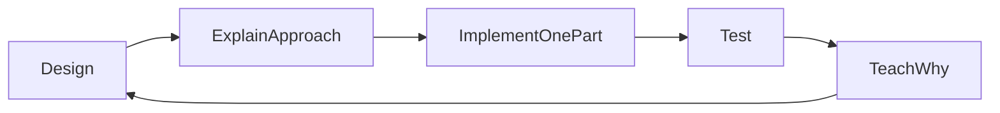
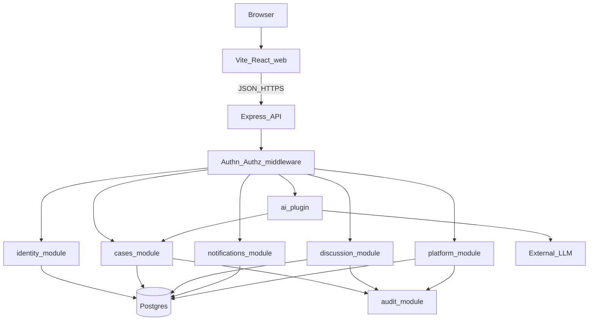
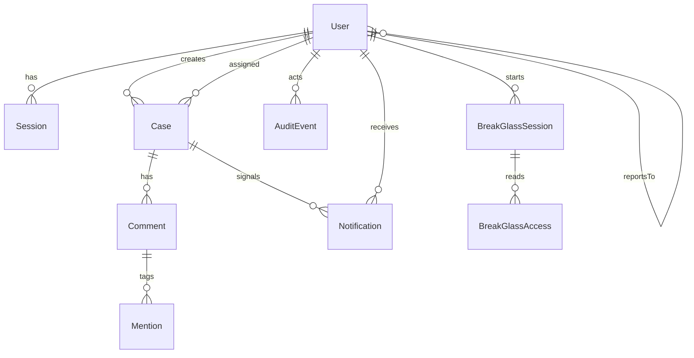
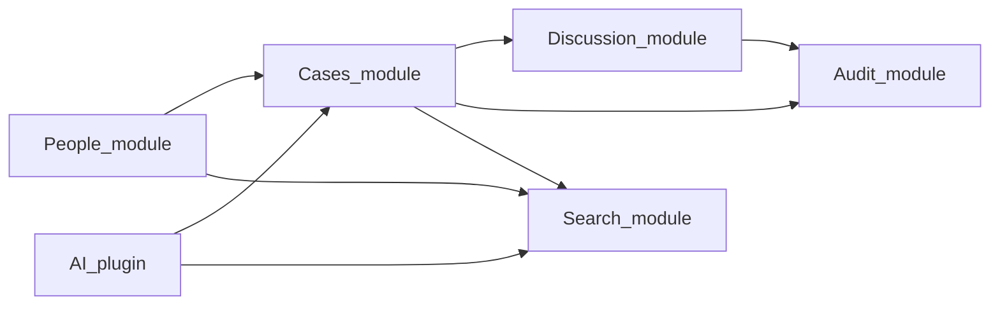
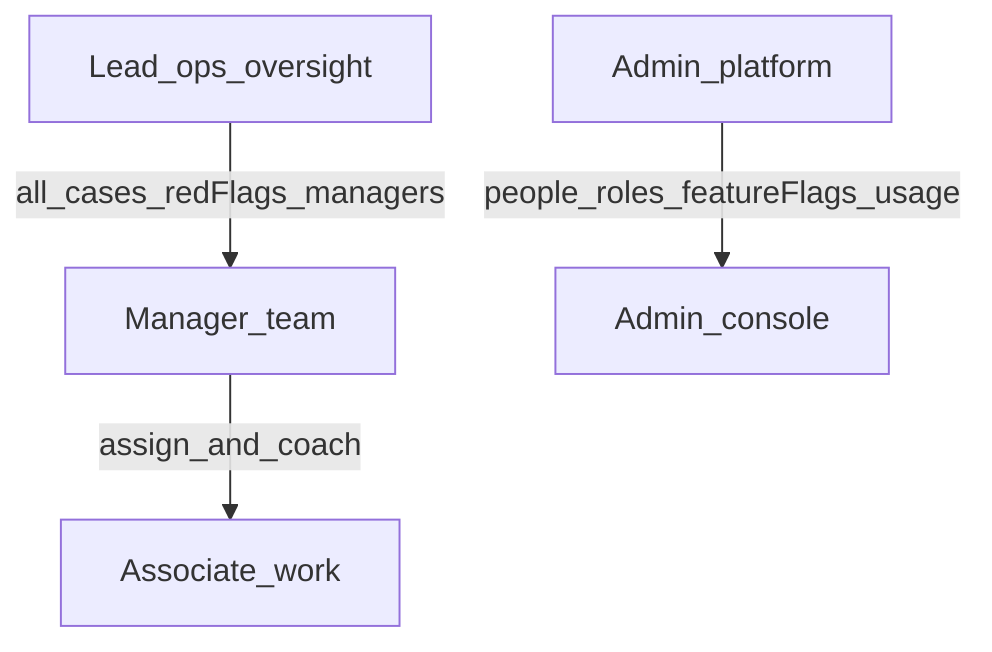
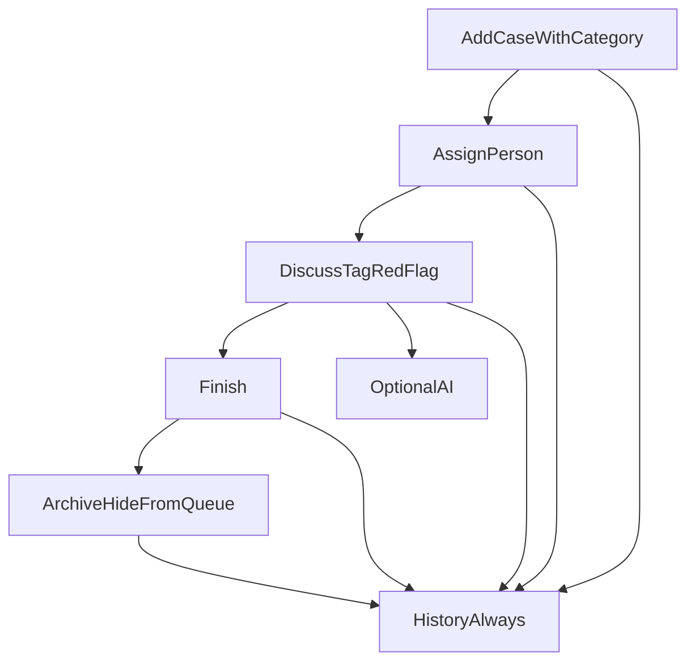

# *OpsNinja Product Requirements Document*

*This document defines **what OpsNinja is** and **what it is not** before any implementation. **Canonical product name: OpsNinja.** Any historical **OpsPilot** wording (including in older `Agents.md` text) is obsolete and must be ignored. No application files or code are part of this naming decision.*

---

## *How we work (project-wide, non-negotiable)*

*This is **not** a “build the whole app for me” project. It is a **learn-by-building** project, in line with Teaching Mode in [Agents.md](c:\Users\gursi\OneDrive\Desktop\OpsNinja\Agents.md).*

***Rejected:** dumping architecture + every screen + every API in one shot, or generating a finished codebase the developer cannot defend.*

***Required loop, every slice:***

1. ***Design** — name the problem, the data, the roles who may touch it, and the failure cases.*
2. ***Explain the approach** — why this shape, what we are not doing, how a request will flow.*
3. ***Implement one part** — the smallest vertical slice that can be tested (e.g. “Associate can add a case,” not “the whole case module”).*
4. ***Test it** — at least one honest check (unit/integration or a manual path). Do not claim it works unverified.*
5. ***Teach why it works** — concept, flow, alternatives, security, how to break it.*

***Slice order later (still one at a time):** auth/users → reporting lines → cases with category → scoped queues → red-flag to Lead → finish/archive → comments/@mentions → Admin flags + usage counts → break-glass read-only → AI plugin.*

*When implementation begins, this loop will also live in* `Agents.md` *and an always-on Cursor rule so future chats cannot silently switch to “just generate everything.”*

---

## *Architecture (explained before any code)*

***Shape:** a **modular monolith**. One backend process, one database, several **modules** with clear boundaries. Not microservices (those would add networks, deploys, and failure modes we do not need). Not a single* `server.ts` *dump either (that becomes unteachable).*

***Delivery (locked):** TypeScript **React (Vite)** frontend talking to a TypeScript **Express** HTTP API, with **Postgres** as the source of truth. An **AI HTTP client** is an optional outbound plugin. Secrets only in environment variables.*

*Why this stack: Vite keeps the UI simple; Express is the most interview-familiar Node server; Postgres is real relational data (users, reporting lines, cases, history). Fastify is a fine substitute later; it does not change the modules.*

### *What talks to what*

***Frontend (*`frontend/`*):** four **shells**, one app. After login,* `/me` *returns role. The router shows Associate queue, Manager team, Lead command, or Admin console. The UI **hides** the wrong buttons. That is convenience only.*

***Backend (*`backend/`*):** the real rules. If the UI is bypassed with curl, the API still rejects an Associate listing the company queue and an Admin reading a case without break-glass.*

### *Backend layers (why they exist)*

*Think of three floors:*

1. ***HTTP (controllers/routes)** — parse the request, call a service, map errors to a consistent JSON shape. No business rules here.*
2. ***Services** — “may this user archive this case?” “notify Lead of a red flag.” This is the product.*
3. ***Data access** — Postgres via an ORM (Prisma is the v1 default: typed models, migrations). SQL stays an implementation detail of this floor.*

*[Agents.md](c:\Users\gursi\OneDrive\Desktop\OpsNinja\Agents.md) requires this split so we can test services without spinning a browser.*

### *Modules (the building, not the rooms)*

| *Module*            | *Job*                                                                             | *Who uses it*                               |
| ------------------- | --------------------------------------------------------------------------------- | ------------------------------------------- |
| ***identity***      | *Login, users, roles, reporting line (Associate→Manager→Lead)*                    | *Everyone; Admin writes people*             |
| ***cases***         | *Add, categorize, assign, red-flag, finish, archive, scoped list/search*          | *Ops funnel only for writes; Admin blocked* |
| ***discussion***    | *Comments, @mentions on a case*                                                   | *Same visibility as the case*               |
| ***notifications*** | *In-app: you were tagged; Lead red-flag inbox*                                    | *Derived from discussion + cases*           |
| ***audit***         | *Append-only history of field changes **and** interactions*                       | *Written by other modules; never edited*    |
| ***platform***      | *Feature flags, usage **counts**, break-glass **sessions***                       | *Admin; Lead **reads** break-glass log*     |
| ***ai***            | *Summarize / next actions / KB search using only data the caller may already see* | *Ops users; Admin can **disable** the flag* |

*Search in v1 is **filtered queries in Postgres** (indexes on assignee, category, redFlag, archivedAt), not Elasticsearch. That keeps one database.*

### *How a request actually moves (the important picture)*

*Example: **Associate finishes a case.***

1. *Browser sends* `POST /cases/:id/finish` *with the session cookie.*
2. *Middleware loads the user (id, role, managerId). Invalid/missing session → 401.*
3. `cases` *service loads the case. If it is not assigned to this Associate (and they are not Lead/Manager in scope) → 403. Admin → 403 (not a case actor).*
4. *Service sets* `finishedAt`*, calls* `audit` *(“finished”, old/new).*
5. JSON `{ ok: true, case }` back. UI updates the queue.

Example: **Red flag.**

1. Same authz as “can I see this case?”
2. Service sets `redFlag = true`, writes audit, writes a **notification** for every Lead and for the case’s Manager.
3. Lead command home reads notifications, not a magic Slack channel.

Example: **Admin tries to open a case.**

1. Default: **403**. Counts on the usage dashboard come from `COUNT(*)` aggregations, not from listing rows with titles.
2. Break-glass: Admin starts a **platform** session (reason required, expires). Then `GET /cases/:id` is allowed **read-only**. Every get is an audit row Lead can list. `POST` still 403.

### Authn and authz (do not mix them)

- **Authentication:** “who are you?” HttpOnly, Secure session cookie (server-side session or signed token in the cookie). Not a token in `localStorage` (XSS would steal it).
- **Authorization:** “may you?” A small policy function per action, e.g. `canViewCase(user, case)`, `canArchive(user, case)`, `canBreakGlassRead(user, session)`. Role + reporting line + case fields. **Never** a `role` field sent by the client as the source of truth.

### What we deliberately do not build in architecture

- One microservice per module
- Message buses for v1 (red flags are a DB write + read)
- Shared Admin/Lead “superuser” table
- AI inside the cases table trigger (AI is a side call; cases work if it fails)

### Folder sketch (for later, not created now)

- `frontend/` — Vite React TypeScript, role shells
- `backend/src/modules/*` — one folder per module (routes + service + tests)
- `backend/src/middleware/` — session, error mapper
- Postgres + migrations when the **data model** slice starts

**Next teaching slice:** first **implementation** slice is identity (users, roles, login session) when you ask to code — not the whole schema dumped at once.

---

## Data model (tables and why, not schema files yet)

A **data model** is the list of facts we persist. If it is not in a table (or derived from one), the product cannot remember it after refresh. We model **nouns the business already uses**, not every UI widget.

**Rules that drive the tables:**
- One company, one Postgres.
- People have **one** role. The org tree is `reportsTo` (Associate → Manager → Lead). Admin is not in that tree.
- A case is never hard-deleted: **finish** and **archive** are timestamps, not `DELETE`.
- Discussion and tags hang off the case.
- History is **append-only**.
- Admin usage stats are **queries** (`COUNT`), not a copy of case text.
- Break-glass is a **session** plus an **access log**, not a second role that can edit cases.

### identity

**User**
- `id` (UUID) — opaque in URLs; sequential ints are guessable (`/users/4`).
- `email` unique, `name`, `passwordHash` (never the password).
- `role`: `admin | lead | manager | associate` (enum, **one** role).
- `reportsToId` nullable FK → User. Associate points at a Manager; Manager at a Lead; Lead and Admin are `null`.
- `deactivatedAt` nullable. We **deactivate**, we do not delete, so history still names a person.
- `createdAt` / `updatedAt`.

**Why not a `Team` table in v1?** A Manager’s team **is** “users whose `reportsToId` is this Manager.” A extra Team table would duplicate that until we have matrix orgs.

**Why not many roles per user?** Harborlane’s funnel is one hat at a time. Multi-role would blur Admin vs Lead.

**Session**
- `id`, `userId`, `expiresAt`, `createdAt`.
- Cookie stores the session id, not the password, not the role. Role is always loaded from `User` on the server.

### cases

**Case**
- `id`, `title`, `description`.
- `category`: `normal | escalation | inventory | vendor | customer | other`.
- `createdById` (reporter), `assigneeId` nullable.
- `redFlag` boolean, default false.
- `finishedAt` nullable — work is done; still on the board until archived.
- `archivedAt` nullable — off the live queue; row remains.
- `createdAt` / `updatedAt`.
- Optional later: `deadlineAt`. Not required to start.

**Live queue query:** `archivedAt IS NULL`. **Open (not finished):** `finishedAt IS NULL AND archivedAt IS NULL`.

**Visibility is not a column.** It is a **query** using User + Case:
- Associate: `assigneeId = me OR (createdById = me AND assigneeId IS NULL)` (exact “created by me” rule as in the role map).
- Manager: cases whose assignee reports to me, or reporter is on my team, or I assigned them (service layer; may add `assignedById` if we need a cheap query).
- Lead: all cases.
- Admin: none, unless an active BreakGlassSession.

Optional `assignedById` is worth adding in v1 if Manager-scope is painful to query. **Recommendation:** include `assignedById` nullable so “I assigned this” is a column, not archaeology in audit.

### discussion

**Comment**
- `id`, `caseId`, `authorId`, `body`, `createdAt`.
- Append-only. No edit table in v1 (keeps history honest).

**Mention**
- `id`, `commentId`, `mentionedUserId`.
- Parsed **once at write time** so notifications do not re-scan every comment body.

### notifications

**Notification**
- `id`, `recipientId`, `type` (`mention | red_flag`), `caseId`, `actorId`, `readAt` nullable, `createdAt`.
- Red flag: one row per Lead + one for the case’s Manager. Not a chat channel.

Lead inbox = `type = red_flag AND recipientId = thisLead AND readAt IS NULL` (plus a full list).

### audit (company memory)

**AuditEvent**
- `id`, `actorId` (nullable if system), `action` (string or enum: `case.created`, `case.assigned`, `case.red_flagged`, `case.finished`, `case.archived`, `comment.added`, `break_glass.started`, `break_glass.read`, …).
- `entityType`, `entityId`.
- `metadata` JSON: old/new field values. Not user-editable. No `UPDATE`/`DELETE` APIs.

Case timeline = audit events for that `entityId` **plus** comments (or comments also emit `comment.added` so one feed can be used). **Recommendation:** comments are rows **and** emit an audit event so the case page can show one activity list.

### platform

**FeatureFlag**
- `key` (e.g. `ai`, `knowledge_base`), `enabled`, `updatedById`, `updatedAt`.
- Disabling hides a module; it does **not** delete cases.

**BreakGlassSession**
- `id`, `adminUserId`, `reason` (required text), `startedAt`, `expiresAt`, `endedAt` nullable.

**BreakGlassAccess**
- `id`, `sessionId`, `caseId`, `accessedAt`.
- Every Admin **read** of a case in emergency mode. Lead can list these. Still no write.

**Usage dashboard:** `SELECT role, COUNT(*) FROM User`, `COUNT(*) FROM Case WHERE archivedAt IS NULL`, login counts from `Session` or `audit` of `auth.login`. **Do not** materialize case titles into an Admin table.

### Later (do not create on day one)

- **KnowledgeArticle** — Lead-owned playbooks for AI search.
- **AiCallLog** — who called which kind of AI, success/fail, **no API keys**, optional truncated prompt.
- Attachments, watchers, custom fields, `organizationId` (multi-tenant).

### Indexes (so queues stay fast)

- User: unique email; `reportsToId`; `role`; `deactivatedAt`.
- Case: `assigneeId`, `createdById`, `archivedAt`, `redFlag`, `category`.
- Notification: `(recipientId, readAt, createdAt)`.
- AuditEvent: `(entityType, entityId, createdAt)`.

### Integrity the database should help with

- FK on `reportsToId`, `assigneeId`, `createdById` — but **role shape** (Associate must report to a Manager) is a **service** rule; Postgres enums will not understand the funnel alone.
- `ON DELETE RESTRICT` on users referenced by cases — force deactivate + reassign.
- Check: cannot set `archivedAt` without a row remaining (always true if we never DELETE cases).

### What we are not modeling (on purpose)

- Soft-delete of cases (`deletedAt`) — archive is enough; two “gone” flags confuse everyone.
- Separate `Status` enum **and** `finishedAt` — pick timestamps so “finished vs archived” stays two verbs.
- Storing `role` on the session or the cookie as authority.
- Admin `CasePermission` god table.

**First schema to implement later (one slice):** `User` + `Session` only. Cases come after login and roles can be tested.

---

**Assumptions (stated because they are not in the brief):**

- Single fictional company, **one tenant** (not a multi-company SaaS in MVP).
- Internal employees only (not a public customer portal).
- The **case is the system of record**. Discussion, tags, and AI hang off the case. We do **not** build Slack-like channels or DMs in v1.
- **Finish** means the work is done. **Archive** (user language: remove) hides it from the live queue. **No hard delete.** History stays.
- AI **assists**; humans **decide**. The product must work if AI is off.
- People follow a **funnel**: Admin (tech, outside the data) → Lead (ops oversight) → Manager (team) → Associate (do the work).
- **Separation of duties:** Admin does **not** have day-to-day case oversight. Official case data is owned by Lead / Manager / Associate. v1 **break-glass** lets Admin **open/read** a case only in an explicit emergency mode that is **logged**; Admin still **cannot** edit, comment, finish, archive, or unarchive that data.
- Reporting line is stored on the user: Associate → Manager → Lead. Admin sets this when adding people.

---

## 1. Problem statement

**Harborlane Retail** (fictional) runs warehouses, last-mile partners, vendors, and a support desk. When something goes wrong—a late truck, damaged inventory, a vendor missing SLA, a store escalation—work is scattered across email, spreadsheets, and chat.

That causes:

- Nobody owns the issue, so it stalls.
- Status and priority live in someone’s head.
- Deadlines are missed without a clear trail.
- Managers cannot see what is open, overdue, or blocked.
- Similar incidents are solved from memory instead of a shared knowledge base.
- Hand-offs lose context (“what happened so far?”).

**OpsNinja’s job:** be the **one place an operational problem lives** until it is finished and archived: categorized, assigned, discussed, red-flagged if it is on fire, searchable, and historically honest.

In beginner terms: Jira is a powerful factory for software tickets. Harborlane does not need sprints, story points, or a workflow builder. They need a **short, honest queue** plus **talk attached to the work**, plus a **phone book of employees**. Slack is where chat goes to die without an owner. OpsNinja keeps the chat **on the case**.

---

## Core idea (why this is a real business product)

**Thesis:** When operations fail, the company does not lack chat. It lacks a **shared memory of the problem**. Email and Slack scatter the story. Spreadsheets lose ownership. Jira is too heavy for warehouse and vendor exceptions.

OpsNinja is Harborlane’s **case of record**:

1. Someone names the problem and **categorizes** it (Normal, Escalation, or another type).
2. A Manager puts an Associate on it.
3. People **discuss on the case** and **@tag** whoever must see it.
4. If it is dangerous or stalled, someone **red-flags** it so Leads see it immediately.
5. When it is done, someone **finishes** it. When it should leave the live board, someone **archives** it.
6. **History** keeps every important change and every discussion so last month’s incident is still explainable.

**Design principles (the “how we build it” contract):**

- **Simplicity** — few screens: Queue, Case, People, Search. Few statuses. Few categories.
- **Functionality** — every control does a real ops verb: add, categorize, assign, discuss, tag, red-flag, finish, archive, search.
- **Practicality** — a Manager can run Monday morning without training slides.
- **Modularity** — Cases, People, Discussion, Search, Audit, AI are separate capabilities so we can add Slack-like chat, dashboards, or attachments later without rewriting the core.
- **Scalability** — start with one company and thousands of cases; later add teams and more modules, not a rewrite.
- **AI is a plugin** — useful for summary, next steps, and knowledge lookup. Never the reason the app exists. Never required to finish a case.

**Inspiration from Jira (keep):** issue as a record, labels/types, assignee, comments, activity history, search/filters.

**Leave in Jira (skip for v1):** boards, sprints, story points, custom workflow engines, epics/roadmaps, dozens of issue types, marketplace plugins.

---

## Primary use cases (the stories the product must win)

1. **Late truck / missed SLA** — Associate logs a **Normal** case. Manager assigns. They comment with facts. Finish when the load lands. Archive when the week is closed.
2. **Store escalation** — Case type **Escalation**. Manager @tags a Lead. Someone **red-flags** it. Lead steps in. Finish when the store is unblocked.
3. **Damaged inventory** — Photos come later (future). For v1, description + discussion + category (e.g. Inventory). History proves who signed off.
4. **Vendor blame ping-pong** — Two teams argue in comments on **one** case instead of three email chains. @tag the vendor-ops Manager. Audit shows the hand-offs.
5. **Monday queue** — Manager filters: my team, red-flagged, Escalation, overdue. Associates see “assigned to me.”
6. **Who is Priya?** — Open **employee profile**: role, maybe team, cases they own, recent comments. Not a social network.
7. **After-action** — Lead searches last month’s Escalations, opens history, explains to leadership what changed and who was tagged.
8. **AI catch-up (optional)** — New Associate opens a long case, clicks summarize, still reads the red-flag and the last two comments before acting.

Niche / advanced ideas (not v1, but the modules should allow them later): SLA clocks, automatic escalate-to-Lead when red-flagged past a deadline, saved Manager views, attachments, Slack-like team channels, customer portal, bulk archive, dashboards.

---

## Feature layers (build in this order)

**Layer A — Foundation (v1, must be useful without AI)**

- Add a case (title, description, **category/type**: at least Normal and Escalation; extra types can be a small fixed list such as Inventory, Vendor, Customer, Other).
- Assign to an employee.
- **Red flag** / unflag (attention, not a replacement for category).
- **Finish** (work is done; still visible in “done” until archived).
- **Archive** (remove from the live queue; **not** hard delete).
- Search and filter (type, red-flag, assignee, status/finish, overdue if we keep deadlines).
- **Employee profiles** (directory: who they are, role, their cases).
- **History** of case field changes **and** discussion events (comments, tags).

**Layer B — Collaboration on the case (v1, Slack-inspired but smaller)**

- Comments on the case (the discussion).
- **@tag / mention** a person; they get an in-app notice that they were tagged.
- No channels, DMs, emoji reactions, or huddles in v1.

**Layer C — AI plugin (v1 if cheap, can ship after A+B)**

- Summarize this case. Suggest next actions. Search knowledge base.
- App remains fully usable if the model is down.

**Layer D — Later modules**

- Slack-like channels/DMs, attachments, SLA, dashboards, team scoping, notifications by email.
- Red flags are **routed to the Lead** (and the case’s Manager). Lead is the ops inbox for fire.
- **Locked decisions:** discussion on the case; archive not delete; Admin is not a super-user of business data.

---

## 2. Target users

Harborlane’s OpsNinja users match how a modern company is usually stacked: one technical operator, one senior operations lead, managers who run the work, and associates who do the work.

| Who                       | What they care about                                                                       |
| ------------------------- | ------------------------------------------------------------------------------------------ |
| **Admin** (tech operator) | Accounts, roles, reporting lines, feature on/off, **usage analytics**. Not the case queue. |
| **Lead**                  | Whole ops picture: open cases, **red-flag inbox**, managers, archive integrity             |
| **Manager**               | Their associates’ queue, assignment, finishing team work                                   |
| **Associate**             | Solve **my** cases: add, discuss, flag, finish                                             |

**Out of scope as users in MVP:** external customers, vendors, warehouse contractors without Harborlane accounts.

---

## 3. User roles

Four roles. Two kinds of power that must not be mixed: **platform power** (Admin) and **operations data power** (Lead → Manager → Associate).

**Recommendation (locked):** Admin should **not** have absolute oversight of everyone else’s case content. A tech admin with a god mode can silently rewrite “what the company officially did.” Harborlane needs the opposite: IT keeps the lights on; operations owns the record. Usage **counts** (how many associates, how many logins, how many cases exist) are enough for Admin to run the app. Full case titles, comments, and archives stay in the ops funnel.

**v1 exception — break-glass (read-only):** If a Lead account is locked or there is an incident, Admin can enter an explicit **Emergency view** and **open** a case to read it. Every entry is logged (who, when, which case, reason). Admin **cannot** change that case, add comments, finish, archive, or unarchive. No silent browsing of the queue without emergency mode.

Authorization is **enforced on the server**.

- **Admin** — Tech operator. Adds/deactivates people; assigns Lead / Manager / Associate; sets who reports to whom; **enables or disables features** (e.g. AI module, knowledge base) without deleting anyone’s cases; **usage dashboard** (role counts, logins, feature usage, **counts** of open/finished/archived cases — not the documents themselves). Does not work the ops queue. Break-glass as above.
- **Lead** — Absolute **ops** oversight of the product’s case features: all open cases, all red flags, all managers, archive/unarchive, reassign across teams. Does not mint Admin, does not flip global feature flags.
- **Manager** — One slice of the funnel: their Associates and that team’s cases. Assigns, coaches, finishes, can archive **their team’s** finished work. Cannot run another Manager’s team. Cannot disable features.
- **Associate** — Bottom of the funnel: create and **solve** cases they own or are assigned. Comment, @tag, red-flag (notifies Manager **and** Lead), finish. Cannot assign others, cannot archive, cannot see the whole company queue.

**Ops inclusion:** Associate ⊂ Manager (team) ⊂ Lead (company). Admin is **orthogonal** and **data-poor** by default.

### Role feature map (v1)

Each row is a small product surface, not a Jira-sized module.

**Admin — platform console (no case queue)**

- Add / deactivate people; cannot hard-delete people who still own cases (deactivate + Lead/Manager reassign first).
- Assign role: Lead, Manager, Associate.
- Set reporting line (Associate’s Manager, Manager’s Lead).
- Usage dashboard: counts of Leads / Managers / Associates, active users, logins, AI calls, **counts** of cases by state (open / finished / archived). No titles, bodies, or comments here.
- Feature flags: turn modules on/off (AI, knowledge base). Disabling **hides** a feature; it does not wipe archived data.
- Break-glass: reason required, **read-only** case open, immutable log visible to Lead.
- Cannot: finish, archive, unarchive, comment, assign, red-flag, edit case fields, disable the audit log.

**Lead — ops command**

- Dashboard: **open-case count**, **red-flag inbox** (every flag is delivered here), per-manager snapshot (open count, flags).
- All company cases: search, filter, history.
- Oversee managers: Manager profile + that team’s queue; @tag; reassign across teams.
- All case verbs: add, categorize, assign, discuss, mention, red-flag, unflag, finish, unfinish, archive, unarchive.
- Optional AI on any case.
- Cannot: create users, change roles, flip global feature flags, skip audit.

**Manager — team slice**

- Team dashboard: open cases on **my** associates, team red flags (also already in the Lead inbox), who is overloaded.
- Scope: cases created by the team, assigned to the team, or assigned by this Manager.
- Assign / reassign among **their** Associates; @tag their Lead.
- Discuss, categorize, red-flag, finish team cases, archive **finished** team cases.
- Full profiles of their Associates; directory of others at least name + role.
- Optional AI on cases they can see.
- Cannot: run another Manager’s team, archive another team’s work, grant roles, disable features.

**Associate — execute**

- My queue: assigned to me + opened by me (until a Manager takes it).
- Add case + category; comment; @tag Manager or Lead; red-flag (Manager + Lead notified).
- Finish cases they are assigned (or still own).
- Directory: name, role, reporting line; own profile.
- Optional AI on **their** cases only.
- Cannot: assign other people, archive, unarchive, see the company-wide queue, see Admin analytics, change roles.

Red-flag routing: write the flag on the case **and** put it in the Lead’s inbox; the responsible Manager’s team dashboard shows it too.

---

## 4. User stories

Format: *As a [role], I want [capability], so that [outcome].*

1. As an Associate, I want to add a categorized case and work **my** queue, so that I can solve what I own.
2. As a Manager, I want to assign cases only to **my** Associates, so that the funnel stays clean.
3. As any ops user, I want to **red-flag** a case and know it lands in the **Lead’s inbox**, so that fire is not a private chat.
4. As an Associate, I want to **finish** my work; as a Manager or Lead, I want to **archive** finished work in my scope, so that boards stay honest without erasing history.
5. As an ops user, I want case comments and **@tags**, so that discussion stays on the record.
6. As a Lead, I want a dashboard of **open cases**, **red flags**, and **per-manager** load, so that I have ops oversight without being every Associate’s supervisor.
7. As a Manager, I want a team dashboard, so that I see overload before the Lead has to intervene.
8. As an Admin, I want to add/deactivate people, set roles and reporting lines, and toggle features, so that I maintain the platform without touching official case text.
9. As an Admin, I want **usage analytics** (role counts, activity, case **counts** by state), so that I can run capacity without reading incidents.
10. As an Admin, I want **break-glass read-only** open of a case with a logged reason, so that incidents are recoverable without a silent god mode.
11. As a Lead, I want to see that an Admin used break-glass, so that platform access of business data is never invisible.
12. As an ops user, I want optional AI only on cases I am allowed to see.
13. As any user, I want to log in with my own account, so that actions are attributable.

---

## 5. Core workflows

1. **Add** — Create a case with category (Normal, Escalation, …). Starts open, usually unassigned.
2. **Triage** — Manager assigns an Associate. Lead can reassign across managers.
3. **Work** — Comments on the case; @tag people; red-flag if needed.
4. **Finish** — Mark the work done. Case can still be opened from Done / search.
5. **Archive** — Remove from the live queue. Record remains searchable in archived filter. **Cannot hard-delete.**
6. **People** — Open a profile from an assignee, a mention, or the directory.
7. **Search** — Keyword + filters including category, red-flag, assignee, finished, archived.
8. **History** — Field changes and discussion/tag events. Not user-editable.
9. **AI (optional)** — Summarize / next actions / KB; never blocks finish.
10. **Access** — Admin grants roles and reporting lines; does not enter the case workflow except break-glass read.
11. **Red flag** — Always notifies Lead; also shows on the responsible Manager’s team dashboard.

---

## 6. Functional requirements

**Accounts**

- Register or seed users is an implementation choice later; **login required** for all case and AI endpoints.
- Roles stored server-side as one of: `admin`, `lead`, `manager`, `associate`.
- Admin is the only role that **grants** Lead / Manager / Associate, sets reporting lines, and deactivates users.
- Admin **feature flags** hide modules; they never purge case rows.
- Admin **usage dashboard** is aggregate metrics only.
- **Break-glass:** explicit mode, reason, log, **read-only** case open. Lead can see the log.

**Cases**

- Fields at minimum: id, title, description, **category/type**, assignee, reporter, **redFlag**, **finishedAt** (nullable), **archivedAt** (nullable), timestamps. Priority and deadline remain useful but category + red-flag are the first-class “how hot is this” controls.
- Starting categories: **Normal**, **Escalation**, plus a short fixed list (e.g. Inventory, Vendor, Customer, Other). Not a custom-field builder in v1.
- Visibility: Associate = mine; Manager = my team; Lead = all; Admin = none except break-glass read.
- **No hard delete.** Archive is the remove action. Unarchive is allowed (edge case).

**Assignment**

- Managers assign **their** Associates; Leads reassign across teams; Associates are not assigners.

**Status**

- Finish / unfinish / archive / unarchive follow the role map (Associate finishes; Manager archives team finished cases; Lead can archive/unarchive anything). Invalid transitions rejected.

**Priority**

- Optional. Category + red-flag are the primary heat controls. Managers/Leads may set priority on cases they can see.

**Discussion (Slack-inspired, case-scoped)**

- Append-only comments on the case.
- **@mentions** of employees; in-app “you were tagged” list or badge. No standalone chat product in v1.
- Mentions and comments are part of **interaction history**.

**People / profiles**

- Directory of employees: name, role, optional team/title, cases assigned, recent activity.
- Not a social feed, not public profiles, not HR files (salary, documents).

**Deadlines**

- Optional datetime; list can show **overdue**.
- No automatic emails/SMS in MVP (in-app overdue filter is enough).

**Search and filter**

- Filter: category, red-flag, assignee, finished, archived, created-by; text search on title/description (comments if cheap).
- Exact search engine (Elasticsearch) is **not** required for v1.

**History (cases + interactions)**

- Case mutations: category, assignee, red-flag, finish, archive, plus older fields if used.
- Interaction events: comments, mentions.
- Visible on the case. History is **not** user-editable. Prefer a simple activity timeline over two separate UIs.

**Knowledge base**

- Articles: title, body, optional tags, updated-by.
- Lead owns playbook content in v1. Admin may toggle the KB **feature** on/off but should not rewrite ops articles.

**AI**

- Summarize case (input = case data the user can already see).
- Suggest next actions (same).
- Knowledge-base Q&A with citations to article titles/ids.
- Failures: user-visible error; case still usable without AI.

---

## 7. Non-functional requirements

- **Simple over clever** — TypeScript, few dependencies, clear services vs routes ([Agents.md](c:\Users\gursi\OneDrive\Desktop\OpsNinja\Agents.md)).
- **Modular** — Cases, People, Discussion, Search, Audit, AI as separate services/modules so Layer D features plug in later.
- **Security** — No secrets in code; env-based config; validate input; authn + authz on API.
- **Auditability** — Mutations and discussions leave a trail; AI calls logged at a high level without storing API keys.
- **Reliability** — Foundation layers work if the AI provider is down.
- **Performance** — Internal team size (tens to low hundreds of users); list pages should feel instant on modest data (thousands of cases), not millions.
- **Testability** — Business rules (transitions, permissions) unit/integration tested; AI mocked in tests.
- **Observability** — Structured errors; consistent API error shape.
- **Learnability / interview** — every slice must be explainable: what changed, why, files, risks, how to test ([Agents.md](c:\Users\gursi\OneDrive\Desktop\OpsNinja\Agents.md) teaching + interview mode).

---

## 8. MVP scope

Must ship:

- Auth + four roles + reporting lines
- Scoped queues (Associate / Manager team / Lead all)
- Add / categorize / assign / red-flag (Lead inbox) / finish / archive
- Case discussion + @mentions
- Lead ops dashboard + Manager team dashboard
- Admin console: people, feature flags, usage **counts**, break-glass read-only
- Profiles / directory, search, history
- Basic web UI per role (Associate queue, Manager team, Lead command, Admin console)
- AI add-on later in the same v1 sequence, scoped to visible cases

MVP success: Admin cannot quietly edit an archived incident; Lead sees every red flag; Manager only runs their funnel; Associate only works their cases.

---

## 9. Future features

- Slack-like **channels and DMs** (modular chat, still linkable to a case)
- Email notifications for @mentions
- Dual-approval break-glass (Admin + Lead must both confirm)
- SLA clocks, auto-escalate stale red flags
- Email notifications for @mentions and red flags
- Attachments and image evidence
- Saved views, bulk assign, bulk archive
- Customer/vendor portal
- AI auto-categorize or draft replies **with human confirm**
- Multi-tenant SaaS, full-text search engine
- Real-time presence on comments

---

## 10. Features to explicitly avoid in MVP

- **Standalone Slack clone** (channels, DMs, huddles) as v1
- **Hard delete** of cases or of history
- Editing audit logs
- Jira-style boards, sprints, story points, custom workflow builder
- Autonomous agents that mutate cases without a human click
- Making AI required to create, finish, or archive a case
- Multi-tenancy, native mobile, billing, BPMN, IoT
- Premature microservices / Kubernetes complexity
- **Big-bang implementation** or “here is the finished app” without the design → explain → one part → test → teach loop
- HR-grade employee files on profiles (keep directory light)
- Admin **god mode** over case text, comments, or archives
- Admin analytics that dump case **content** (counts only)

---

## 11. AI features and why they are useful

| Feature          | Why it helps humans                                                       | Guardrail                                             |
| ---------------- | ------------------------------------------------------------------------- | ----------------------------------------------------- |
| **Case summary** | New assignee or manager skips 20 comments and still understands the story | Grounded in this case only; labeled as AI-generated   |
| **Next actions** | Reduces blank-page time; encodes common ops patterns                      | Suggestions only; no auto status change               |
| **KB search**    | Turns playbooks into answers with sources                                 | Answers must cite articles; if KB has nothing, say so |

AI is a **good integration**, not the product. Ops work is high-context and interrupt-driven, so recap and playbook search help. The app must still **add, flag, discuss, finish, and archive** with the model switched off. AI must not invent policy or auto-finish cases.

---

## 12. Security requirements

- Authenticate every API that reads or writes cases, comments, mentions, profiles, users, KB, or AI.
- Authorize by **role + resource + team scope** on the backend (Lead all cases; Manager team; Associate mine; Admin none by default).
- Never trust the client for role, assignee, or status.
- Only Admin may change another user’s role or reporting line.
- Case APIs reject Admin writes. Case **reads** by Admin require an active break-glass session + reason; sessions expire; events are immutable and visible to Lead.
- Feature flags must not delete data.
- Validate and limit lengths of titles, bodies, comments, and AI prompts.
- Secrets only in environment variables.
- Rate-limit AI endpoints (cost and abuse).
- Do not send other users’ private HR data to the model if it is not on the case (MVP: only case + allowed KB).
- Audit log of security-relevant events (login failures later; at least mutations now).
- Least privilege for DB and AI API keys.
- XSS-safe rendering of comments and markdown later; store as text first.

---

## 13. Important edge cases

- Unassigned cases sitting open forever
- Archive vs finish confusion (finished but still on the live board until archived — UI must make this obvious)
- Unarchive / unfinish / unflag races
- @mention of a deactivated user
- Red-flag storms (everything flagged; Lead sees noise — later we may limit who can flag)
- Hard-delete requests from users (product answer: archive only)
- Assigning a deactivated/unknown user
- Deadline in the past at creation
- Concurrent edits (two people change status; last-write-wins vs conflict—document a simple rule)
- Reopen after Closed; who is allowed
- Empty description or title-only spam cases
- Very long comment threads vs AI token limits (summarize with truncation strategy)
- AI timeout / provider 429 / empty model output
- KB empty or irrelevant → AI must not invent company policy
- Associate tries to reassign a Critical case or change another person’s role (reject)
- Manager tries to change a peer Manager’s role or act as Admin (reject)
- Lead tries to create users or grant Admin (reject unless we later add a break-glass story)
- Admin assigned as case owner (reject)
- Admin browsing the queue **without** break-glass (reject)
- Break-glass without a reason, or write attempts during break-glass (reject)
- Associate seeing another team’s cases (reject)
- Manager assigning an Associate who reports to a different Manager (reject)
- User deactivated while assigned (block until reassigned; prefer deactivate, not delete)
- Filter combinations that return zero rows (empty state, not an error)
- User deleted while assigned (block delete or reassign first—prefer **deactivate**, not delete)
- Clock/timezone on deadlines (store UTC, display local)

---

## Reasoning (beginner-friendly)

Harborlane’s real problem is not “we need Jira.” It is “when something breaks, the story lives in five places.” OpsNinja is the **single memory of that story**.

Jira taught us: a ticket, a type, an owner, comments, a history. We keep that and drop the factory floor. Slack taught us: tag people and talk. We keep tagging, but **talk stays on the case** so it cannot vanish into a channel.

**Finish** means done. **Archive** means “get it off my board” without lying to the future. **Red flag** means “look now,” separate from whether the case is an Escalation type.

Two powers stay split on purpose. **Admin** is IT: people, switches, usage numbers. **Lead** is operations: every case, every red flag, every archive. That is how you stop one person from both running the servers and rewriting history. Break-glass is a fire alarm with a log, not a spare set of keys to the filing cabinet.

The funnel is how work actually moves: Lead sees the building, Manager sees a floor, Associate sees their desk.

We will not skip understanding to get to code. Each future change is a **class**, not a delivery: design it, explain it, build a thin slice, test it, teach why that slice works. That is how this stays a portfolio project you can defend, not a black box someone generated.

**Next stages:** persist the teaching loop in `Agents.md` + a Cursor rule when coding starts; first **code** slice is `User` + `Session` (login and four roles), then reporting lines, then cases — not the whole schema at once.