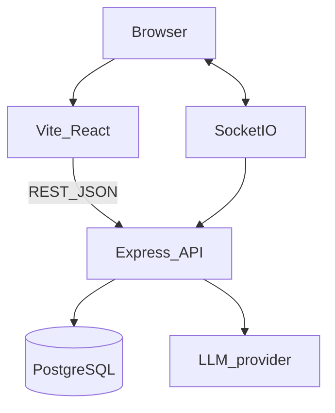

# OpsNinja — Architecture

**Status:** Current with v2 task module and role-aware Summary.



## Modular monolith

```text
backend/src/
  config/
  middleware/
  modules/
    identity/
    tasks/
    communication/
    notifications/
    audit/
    platform/
  realtime/
  app.ts
  server.ts
frontend/   Vite React Tailwind role-aware shell
```

Thin HTTP controllers. Services own policy and workflows.

## Authentication

HTTP-only session cookie stores session id. Password hashed with Argon2id. Role loaded from `User`.

## Authorization

Central policy (`canViewTask`, `canAssignTask`, `canSelfAssignTask`, …). Admin does not see task content.

## Tasks

Creator, `visibilityType` (`GLOBAL`/`TEAM`/`DIRECT`), and `assigneeId` are independent. `TaskAccess` holds DIRECT grants. `workKind` is intake type. Due is computed from `dueAt`. Board layout uses `boardColumn` + `boardRank`; `POST /api/tasks/:id/board` moves a card.

`GET /api/tasks/dashboard` returns role-shaped cards plus a mutually exclusive attention chart.

## Communication

`Conversation` (`GLOBAL` | `DM`) + participants + `Message`. Postgres is source of truth. Socket.IO for live delivery.

## Admin

`GET /api/platform/metrics` — users, sessions, roles, flags, audit count. `POST /api/users` onboard.

## Deployment (target)

Frontend on Vercel **or** Express serving the SPA on Render. API + Socket.IO on Render. Managed PostgreSQL.

## Future

Shared pub/sub if horizontally scaled. RAG module.
