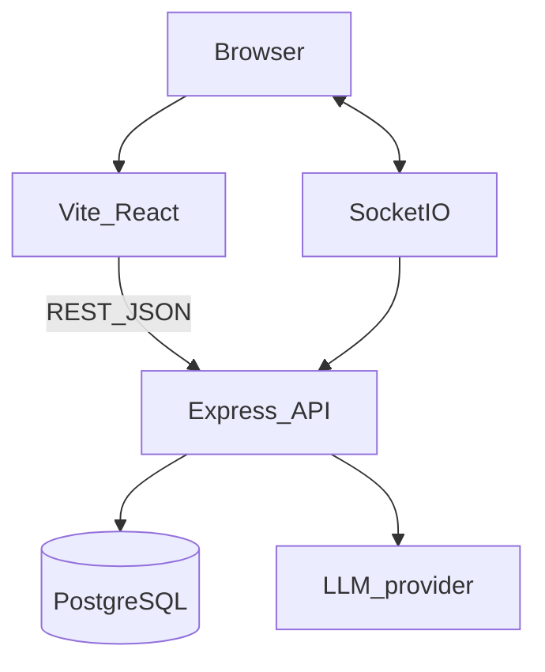

# OpsNinja — Architecture

**Status:** Current design. Update Implemented sections when code matches.



## Modular monolith

```text
backend/src/
  config/
  middleware/
  modules/
    identity/
    cases/
    communication/
    notifications/
    audit/
    platform/
    ai/
  realtime/
  app.ts
  server.ts
frontend/   Vite React Tailwind role-aware shell
```

Thin HTTP controllers. Services own policy and workflows. Repositories talk to Prisma.

## Authentication

HTTP-only session cookie stores session id. Password hashed with Argon2id. Role loaded from `User`. No localStorage tokens.

## Authorization

Central policy (`canViewCase`, `canAssignCase`, …). Evaluated on the server. Visibility + assignment + role. Admin does not see case content without break-glass.

## Cases

Creator, `visibilityType` (`GLOBAL`/`TEAM`/`DIRECT`), and `assigneeId` are independent. `CaseAccess` holds explicit grants for DIRECT (and extra grants as needed). TEAM uses `visibilityManagerId` plus reporting tree. GLOBAL is workspace-wide for operational roles.

## Communication

`Conversation` (`GLOBAL` | `DM`) + participants + `Message`. Postgres is source of truth. Socket.IO rooms for live delivery. Cursor pagination. Mentions parsed at write time.

## Realtime

Socket.IO authenticated with the same session. Reconnect loads missed messages from DB.

## Notifications / audit

Notifications: small records with type, recipient, source ids, readAt. Audit: append-only system actions. Chat messages are not audit rows.

## AI

Provider interface. Timeouts, rate limits, feature flag. Same access as `canViewCase`. No writes.

## Deployment (target)

Frontend on Vercel **or** Express serving the SPA on Render if cookies/WebSockets are simpler. API + Socket.IO on Render. Managed PostgreSQL. First production gate: login + users + basic cases.

## Implemented

Not yet running in production at rewrite time.

## Future

Shared pub/sub if horizontally scaled. RAG module. Group conversations (`Conversation.type` reserved).
