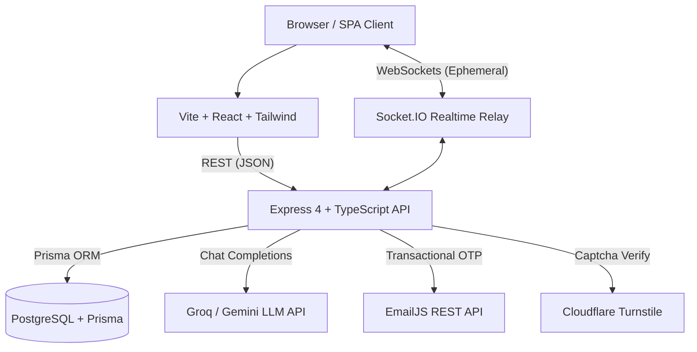

# OpsNinja — Architecture

**Status:** Current with modular monolith, SimuAI Groq/Gemini engine, DM lifecycle, 48-hour auto-archiving, role-based log separation, and mandatory admin approval gate.



## Modular Monolith

```text
backend/src/
  config/              # Validated environment configuration (env.ts)
  middleware/          # Session auth, role gates, error handling
  modules/
    identity/          # Auth, Argon2id, EmailJS OTP, Turnstile, Users, Approval Gate
    tasks/             # Policy, RBAC, fractional rank, task service, 48h archive worker
    communication/     # Chat service, DM lifecycle, clearedAt, Socket.IO rooms
    platform/          # Admin metrics, user management, audit logs, log service
    ai/                # AiProvider, Groq, Gemini, Mock providers, rate limiter
  lib/                 # Prisma client, logger, errors, asyncHandler
  server.ts            # HTTP & Socket.IO server entrypoint, archive worker lifecycle
frontend/              # React 18, Vite 5, Tailwind CSS 4, React Router 6, Markdown
```

Thin HTTP controllers; modules encapsulate business logic, domain policies, and authorization boundaries.

## Identity & Authentication

1. **Passwords:** Pure Argon2id hashing via `hash-wasm` (WASM; no native Windows C++ toolchain required).
2. **Bot Verification:** Cloudflare Turnstile verification on self-service registration and login.
3. **Two-Step Verification:** 6-digit numeric OTP generated via `crypto.randomInt`, stored strictly as SHA-256 hashes, dispatched via EmailJS REST API client with timeout protection (10-minute TTL, 5-attempt brute-force protection, 60s cooldown).
4. **Mandatory Admin Approval Gate:** Following email verification, accounts require administrative approval (`approvedAt != null`) before login is permitted. Unapproved accounts receive HTTP 403 `account_pending_approval`.
5. **Session Management:** Cryptographically random 32-byte tokens in PostgreSQL `Session` table, issued in HTTP-only `opsninja.sid` cookies.

## Authorization & Policy

Central policy in `modules/tasks/policy.ts` (`canViewTask`, `canAssignTask`, `canSelfAssignTask`, `canFinishTask`, `canArchiveTask`).
- **Creator**, **Visibility**, and **Assignee** are strictly decoupled.
- **Admin Isolation:** Admin represents platform identity and system infrastructure; **Admin sees no task content** (no exceptions). Task content is redacted in audit logs when viewed by Admins.

## Tasks & 48-Hour Auto-Archiving

- **Intake & Visibility:** `workKind` (`task|escalation|backlog|report`), `visibilityType` (`GLOBAL|TEAM|DIRECT`), `TaskAccess` holds explicit DIRECT grants.
- **Board View:** Stores `boardColumn` (`TODO|IN_PROGRESS|IN_REVIEW|DONE`) and fractional `boardRank`. Moving cards synchronizes completion state.
- **Dynamic Deadlines:** **Due** is dynamically computed (`finishedAt == null && dueAt < now`).
- **48-Hour Auto-Archiving:**
  - Tasks transitioning to Complete record `finishedAt` and `completedAt`, and compute `archiveAfter = completedAt + 48 hours`.
  - Non-status edits preserve the active countdown.
  - A background sweep processor (`sweepArchivedTasks`) runs on server startup and every 5 minutes, automatically moving overdue completed tasks to `archivedAt = now`.
  - Archived tasks are excluded from daily operational boards, calendar views, and summary counts.
  - Authorized Leads and Managers can restore tasks, which clears `archivedAt` and grants a fresh 48-hour review window (`archiveAfter = now + 48h`).
  - Reopening a completed or archived task resets all completion and archival timestamps.

## Realtime Chat & Direct Messages

- **Storage & Relays:** PostgreSQL is the single source of truth for messages and conversations. Socket.IO acts as an ephemeral event relay.
- **DM Lifecycle:** 1:1 Direct Messages use deterministic pairing keys (`directKey: minId:maxId`) to eliminate duplicates. Starting a conversation requires participant checks to avoid permanent empty ghost conversations.
- **Delete for Me:** `clearedAt` on `ConversationParticipant` hides past messages for the requesting user until a new message arrives, without destroying the other participant's history.
- **Room Authorization:** Socket.IO handshake enforces session and approval parity; room joins verify participant authorization, emitting `FORBIDDEN` on unauthorized access.

## Role-Based Activity & System Audit Logs

- **Task Activity Logs (Regular Users):** Scoped strictly to visible tasks; limited to `task.created`, `task.assigned`, and `task.completed`.
- **System Audit Logs (Administrators):** Covers account lifecycle (`user.*`) and platform maintenance events. Task content is redacted.

## SimuAI Intelligence Layer

- **Provider Abstraction:** Implements `AiProvider` supporting:
  - **Groq:** `openai/gpt-oss-20b` (default hosted LLM via OpenAI-compatible chat completions).
  - **Gemini:** `gemini-3.8-flash` via Google GenAI REST API.
  - **Mock:** Zero-key deterministic fallback for tests and offline development.
- **Non-Destructive Assistance:** Generates markdown operational briefings on `Summary`, and task summaries, checklists, and catch-up digests on `TaskDetail`. AI never mutates tasks.
- **Resilience:** 30 req/min rate limiting (`aiLimiter`) and graceful degradation if external AI APIs encounter errors or rate limits.

## Deployment Target

- Frontend on Vercel **or** Express serving the SPA on Render.
- API + Socket.IO on Render Web Service.
- Managed PostgreSQL on Render or Neon.
